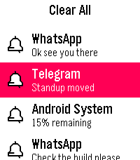
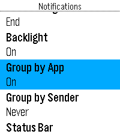
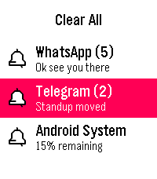
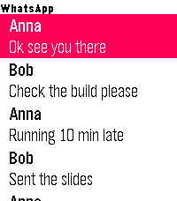

# Notification Sync in stock PebbleOS

This folder contains changes that make the **stock PebbleOS Notifications app** mirror the
phone's notification shade, as Notification Sync does today. It holds patches for two upstream
projects, screenshots from the emulator, and draft PR text.

Firmware branch: **`TomBolger/PebbleOS-NS` → `notifications-mirror-phone`** (a GitHub fork of
`coredevices/pebbleos`, rebased onto upstream `e8705dfcd`). The same commits are also exported as patches below.

| Project | Upstream | Base commit | Patches |
| --- | --- | --- | --- |
| PebbleOS firmware | `coredevices/pebbleos` | `e8705dfcd` | `patches/pebbleos/` (5 commits) |
| Core phone library | `coredevices/libpebble3` | `f324f3f` | `patches/libpebble3/` (1 commit) |

## What upstream already has (Nov 2026)

Upstream has recently added some of the pieces this work builds on:

- **Dismissal sync** (`notifDismissalSync`, commit `31f91bc19` and follow-ups). This setting is
  off by default and the Core app turns it on. While it is on, a notification that is dismissed
  or acted on (on the phone or on the watch) is hidden from the watch's history, and a
  re-delivered copy of a dismissed notification is dropped.
  - Android: Core already sends a status update when a notification leaves the shade, so live
    removal works.
  - iOS: an ANCS "removed" event marks the stored notification dismissed, so live removal works.
- **Group by Sender** (Settings → Notifications), for Android notifications only, limited by
  age (1 day, 1 week or all).
- `notif_db_delete()` sends `NotificationRemoved` events, and both the popup and the
  Notifications app handle them.

So live removal is already mirrored. What was still missing:

1. **iOS after a reconnect or a watch reboot.** Notifications that were already on the phone were
   ignored, and anything you cleared on the iPhone while the watch was away stayed on the watch
   for good.
2. **Organization.** The stock list was flat, or grouped by sender on Android only. Phones stack
   notifications by app.

## What these patches add

### Firmware (`coredevices/pebbleos`)

All of this applies only while dismissal sync is on ("mirroring"). The behavior with it off is
unchanged.

1. `services/notifications/ancs: keep the notification center when mirroring it`
   - Recovered (pre-existing) iOS notifications are stored whatever their age. Only ones missed
     during the disconnection alert, the same rule as before.
   - New `ancs_notifications_handle_snapshot(uids, count)` drops stored iOS notifications whose
     UID the phone no longer reports. It works in batches of 8, so it allocates nothing.
   - A new notification replaces a stored one that has the same UID. UIDs restart when iOS
     restarts.
2. `comm/ble/ancs: drop notifications removed from iOS while disconnected`
   - After subscribing to the Notification Source, the client collects the UIDs iOS re-sends
     for 10 s (iOS re-sends its whole Notification Center then), and then reconciles them.
   - The snapshot is abandoned and nothing is deleted if more than 128 UIDs arrive, if any NS
     event was dropped before reaching KernelMain, or if the session ends first.
   - Pre-existing notifications are also fetched on the first connection after boot (storage is
     wiped at boot), so the history starts out matching the phone.
3. `services/notifications: add a preference to group notifications by app` (`notifGroupByApp`)
4. `apps/notifications: stack notifications by app`
   - Groups by the `AppName` attribute for **both iOS and Android**, ignoring the age range. A
     notification without an app name stays on its own row.
   - An opened stack shows *who* each notification is from, plus its text. The stack's title is
     the app's name.
5. `apps/settings: add a Group by App notification setting` (a toggle next to Group by Sender)

### Phone (`coredevices/libpebble3`)

1. `Send the app name with Android notifications`. iOS notifications already carry `AppName`,
   but Android ones did not, so the watch had nothing to stack them by.
   - Side effect to mention in the PR: the stock list already shows `AppName` in place of the
     title when an Android notification has the generic icon. This now happens on Android too,
     as it already does on iOS.

## Screenshots (qemu_emery, built from these patches)

| Before (flat list) | Setting | After (stacked by app) | Opened stack |
| --- | --- | --- | --- |
|  |  |  |  |

The notifications come from `pbl emulator feed notifications`, which sends `AppName` the way the
patched phone app does.

## Testing done here

- Full host suite: every test that doesn't render to the screen passes. The rendering tests
  (graphics, health, music, notification window and others) fail here only because the test
  build was configured without its reference images (`PBL_TEST_IMAGES=OFF`). Run `pbl test` to
  get a full result.
- Host unit tests: `test_ancs` (6 new cases), `test_ancs_notifications` (2 new),
  `test_notifications_history` (3 new), plus `test_notif_db`, `test_notification_storage` and
  `test_alerts_preferences`. All pass. The full-suite result is in the session notes.
- The firmware builds for `qemu_emery` with no warnings, and Group by App was exercised in the
  emulator (screenshots above).
- clang-format 22 was run on all touched C files.
- **Not done:** real hardware, iOS (ANCS can't be emulated), and building the Android app.

PebbleOS's contribution rules require all three of these before review: hardware proof, an
iPhone test, and photos or video.

## Before opening PRs (things only you can do)

1. **Talk to the maintainers first.** `docs/community/contributing.md` asks for that before
   new features. A draft issue is in `PR_DRAFTS.md`.
2. **Test on a watch with an iPhone:**
   - Clear notifications on the iPhone while the watch is out of range, then reconnect. They
     should disappear from the watch within about 10 s.
   - Reboot the watch. The list should fill in with what is in Notification Center, without
     buzzing.
   - Check a Notification Center with 30+ items, an iPhone reboot (UIDs start over), and a
     phone call during reconnect.
   - The open question is whether iOS keeps the same ANCS UIDs across BLE reconnects without
     an iPhone reboot. The patches assume it does. If it doesn't, the snapshot will still be
     correct, but more notifications get re-fetched.
3. **Sign the commits with your own identity** (DCO). The commits are authored as
   `TomBolger <…noreply…>` with no `Signed-off-by`, and upstream gitlint rejects noreply emails
   and one-word names:

   ```sh
   git am pebbleos-native/patches/pebbleos/*.patch            # in a pebbleos checkout at e8705dfcd
   git rebase e8705dfcd --exec 'git commit --amend --no-edit --reset-author -s'
   gitlint --commits e8705dfcd..HEAD
   ```

   The commits keep the `Assisted-by: LLM` trailer that upstream requires, and name no tool.
4. **Send it as two PRs**, since big PRs are closed: (a) iOS mirroring, commits 1–2;
   (b) Group by App, commits 3–5. The libpebble3 change can go in alongside (b).

## Not covered yet (possible follow-ups)

- **Android shade sections** (Conversations / Notifications / Silent, and Android 15's
  Promotions / News / Social), which Notification Sync shows. PebbleOS has no attribute for
  these. It would take a new timeline attribute from libpebble3 plus section headers in the
  list.
- **Android reconnect reconciliation** belongs in the phone app: on reconnect, libpebble3 should
  delete watch notifications that are no longer in the shade. The firmware's
  `notif_db_delete()` already handles that.
- Notification Sync's extra actions (snooze, per-channel mute, image viewer) remain app-only.
